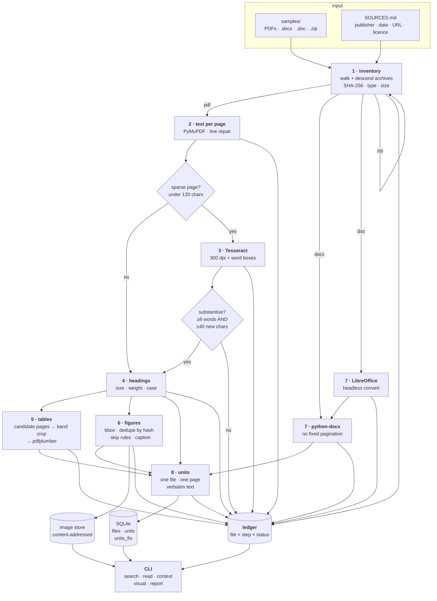

# doc-provenance-pipeline

Turns a folder of mixed documents — text PDFs, scans, Word files, zip archives —
into a searchable library of small units. Every unit keeps the identity of the
one file it came from and the page it sits on, and every processing step records
an honest status: **a step that ran is not the same as content that was
recovered.**

```
$ python -m dpp search "milligrams per liter" --limit 1

1 result(s) for 'milligrams per liter'

1. [passage] 9d79e7bb-p0006-010   (bm25 -20.19)
   source   : usgs_sir2016-5092_corrosivity.pdf  page 6
   publisher: U.S. Geological Survey   date: 2016-07-12
   heading  : Supplemental Information
   snippet  : Concentrations of chemical constituents in water are given in either
              [milligrams] [per] [liter] (mg/L) or micrograms [per] [liter] (µg/L).
```

## What it does

1. **Inventory** — walks the input folder, descends into `.zip` archives,
   SHA-256s every file, detects its type from magic bytes, records its size.
   Archive members keep a reference to their parent archive.
2. **Text per page** — PyMuPDF, one page at a time. Pages whose text layer
   yields almost nothing are *sparse*, and those are the only pages OCR runs on.
3. **OCR, honestly** — Tesseract on sparse pages only. Whether OCR *recovered*
   anything is a separate judgement from whether it *ran*: a scanned page of
   prose and a full-page map both get OCR'd, and only one of them produces
   substantive text.
4. **Headings** — inferred from font size, weight and case, so every passage
   knows its nearest heading, carried across page breaks.
5. **Tables** — pdfplumber, with column headers and captions preserved
   **exactly as written**, because that is the only place a table records what
   its numbers mean. Stored twice: structured rows, and a flat readable version
   for search.
6. **Figures** — image placements with page and bounding box, deduplicated by
   content hash, filtered by an explicit decorative-image rule, with the nearest
   caption and surrounding text attached. The original image file is preserved
   so the visual survives.
7. **Word documents** — `.docx` via python-docx; legacy `.doc` via headless
   LibreOffice, or recorded as `source_dependent` when no converter exists.
8. **Index** — SQLite with an FTS5 index over passages, table text, captions and
   image descriptions.

Optional: `--describe-images` adds a vision description per figure via the
Anthropic API. **Off by default** — without it the pipeline makes no API calls
and costs nothing to run, and a figure that was not described is recorded as
undescribed rather than given an invented caption.

## Architecture



Every stage writes its own ledger row, so a file that fails at one stage keeps
whatever earlier stages recovered. A crash in one document never ends the run.

### The five statuses

| Status | Meaning |
|---|---|
| `recovered` | The step ran and produced substantive new content. |
| `no_new_content` | The step ran, completed, and produced nothing substantive. |
| `failed` | The step raised. The exception type and message are the detail. |
| `source_dependent` | The file cannot be processed as supplied; it needs an export or a replacement from its publisher. |
| `skipped_by_rule` | A configured rule excluded it. The detail names the rule and its threshold. |

`record_outcome()` takes a *measured count* of recovered content and derives the
status from it, so no caller can write `recovered` for an empty result.

### What a unit stores

| Column | Notes |
|---|---|
| `unit_id` | readable and stable: `<file><page><ordinal>`, e.g. `9d79e7bb-p0013-002` |
| `file_id`, `source_path` | the **one** file it came from; units are never built from two sources |
| `publisher`, `doc_date` | copied from `SOURCES.md`; `NULL` where the publisher states nothing |
| `page` | 1-based, or `NULL` for formats with no fixed pagination |
| `heading` | nearest preceding heading, carried across page breaks |
| `unit_type` | `passage`, `table` or `figure` |
| `text` | verbatim — no paraphrasing, no normalising, no unit conversion |
| `caption` | the publisher's own caption, wrapped lines joined |
| `image_path` | the preserved original image, for `figure` units |
| `image_description` | model output, only when `--describe-images` ran; `NULL` otherwise |
| `table_rows` | structured header lines + data rows, as JSON |
| `bbox`, `page_ordinal` | where on the page, and in what reading order |
| `from_ocr`, `ocr_confidence` | whether the text came from OCR, and how confident Tesseract was |

`files` additionally carries `sha256`, `size_bytes`, `media_type`,
`parent_archive_id`, `source_url` and `license`, all of which `read` and
`visual` print.

## Install

Python 3.11+.

```bash
python -m venv .venv
. .venv/bin/activate          # Windows: .\.venv\Scripts\activate
pip install -e ".[dev]"
```

### System dependencies

| Tool | Needed for | Without it |
|---|---|---|
| **Tesseract OCR** (+ `eng` data) | reading sparse / image-only pages | those pages are recorded `source_dependent`, naming the missing binary |
| **LibreOffice** (`soffice`) | converting legacy binary `.doc` | `.doc` files are recorded `source_dependent: needs export or replacement` |

Both are located at run time from `PATH`, then `DPP_TESSERACT_CMD` /
`DPP_SOFFICE_CMD`, then the platform's conventional install locations. Which one
was used is printed at the start of every build.

```bash
# Debian / Ubuntu
sudo apt-get install tesseract-ocr tesseract-ocr-eng libreoffice-writer default-jre-headless
# macOS
brew install tesseract libreoffice
# Windows
winget install UB-Mannheim.TesseractOCR TheDocumentFoundation.LibreOffice
```

Or skip all of it and use the image, which installs both:

```bash
docker build -t dpp .
docker run --rm -v "$PWD/samples:/data/samples" -v "$PWD/work:/data/work" dpp build /data/samples
docker run --rm -v "$PWD/work:/data/work" dpp search "mg/L"
```

The image asserts at build time that both binaries resolved and that SQLite has
FTS5, so a broken image fails loudly instead of quietly recording
`source_dependent` at run time. It has **not** been built and run here, though —
the development machine has no Docker — so treat the image itself as unverified
while the pipeline and tests it packages are not.

The pipeline also needs a SQLite built with FTS5 (standard in CPython);
`python -m dpp` checks and says so if not.

## Run

```bash
python -m dpp --work-dir work/index build samples     # full pipeline
python -m dpp --work-dir work/index refresh samples   # only new or changed files
python -m dpp --work-dir work/index search "mg/L"
python -m dpp --work-dir work/index read    <unit_id>
python -m dpp --work-dir work/index context <unit_id>
python -m dpp --work-dir work/index visual  <unit_id>
python -m dpp --work-dir work/index report
```

Those are all of the commands. `--work-dir` decides where the database, the
content-addressed image store and extracted archive members live; nothing is
written outside it and no path is hardcoded.

A full `build` over the sample set (11 files, ~370 pages, 23 pages OCR'd) takes
roughly 10 minutes on a laptop — most of it Tesseract at 300 dpi and pdfplumber
loading vector-heavy map pages. `--max-pages 5` gives a fast smoke run.

Useful knobs on `build` / `refresh` (every threshold in `dpp/config.py` is
configurable; these are the ones exposed on the command line):

```
--sparse-min-chars N       a page with fewer extractable characters is OCR'd  (120)
--ocr-dpi N  --ocr-lang L  rendering resolution and Tesseract language        (300, eng)
--image-min-px N           skip images smaller than this in either dimension  (80)
--image-min-area-frac F    skip images covering less of the page than this    (0.01)
--image-max-area-frac F    skip images covering more than this — a page scan  (0.75)
--max-pages N              cap pages per document, for smoke runs             (no cap)
--describe-images          vision descriptions via the Anthropic API          (off)
--sources PATH             provenance sidecar          (<input_dir>/SOURCES.md)
```

## The sample set

`samples/` holds nine documents from four US federal agencies — USGS, NACA/NASA,
EPA and FWS — chosen to cover the cases that break naive pipelines. (`report`
counts five publishers because it counts distinct publisher *strings*, and the
1909 paper names the Government Printing Office alongside USGS.) `SOURCES.md`
records each one's title, publisher, date, URL and licence — and is
**machine-read** by the pipeline, so the documentation and the metadata on each
unit cannot drift apart.
Where a publisher states no date, it reads `unknown`, and `unknown` is what
`search` and `read` display. Nothing is inferred.

| File | Role in the test set |
|---|---|
| `usgs_sir2016-5092_corrosivity.pdf` | text PDF; tables whose headings carry units (mg/L, µg/L) |
| `usgs_sir2020-5116_nwqn.pdf` | second table-heavy report |
| `nasa_naca_report_1135_compressible_flow.pdf` | 1953 scan; captioned numeric tables, charts, and a text layer with no line structure |
| `usgs_wri1992-4036_water_quality_recon.pdf` | scan with figures and diagrams |
| `usgs_wsp0234_conservation_1909.pdf` | genuine 1909 scan with image-only plate pages |
| `usgs_fs2018-3024_imageonly_scan_derived.pdf` | **derived** — image-only pages that force the OCR path |
| `epa_dpcr_dataset_description.docx` | Office Open XML; also the no-pagination case |
| `fws_wc_report_form.doc` | genuine legacy binary Word (OLE2) |
| `usgs_factsheets_bundle.zip` | **derived** — archive whose two members must be inventoried separately |

Two of the nine are derived rather than downloaded, and `SOURCES.md` says so
with the parent document and the exact derivation. `tools/make_derived_samples.py`
rebuilds both. The reason: **every government scan tested already carried an OCR
text layer**, so none of them forces OCR on pages of real body text — the image-only
sample is the first three pages of a USGS fact sheet rasterised at 200 dpi with
the text layer discarded (the script asserts 0 extractable characters
afterwards). The `.zip` is a container for two fact sheets that were downloaded
verbatim.

## Example output

Real output from the sample set, trimmed only where marked `[…]`. Reproduce with
`python -m dpp --work-dir work/index build samples`.

### build

```
$ python -m dpp --work-dir work/index build samples

input      : samples
work dir   : C:\Users\abder\doc-provenance-pipeline\work\index
database   : C:\Users\abder\doc-provenance-pipeline\work\index\ledger.sqlite3
tesseract  : C:\Users\abder\AppData\Local\Programs\Tesseract-OCR\tesseract.exe
libreoffice: C:\Program Files\LibreOffice\program\soffice.exe
describe   : OFF (no API calls, no cost)

11 files seen, 11 processed, 0 unchanged, 3799 units written, 23 pages OCR'd

Run 'python -m dpp report' for status counts and unresolved items.
```

### refresh

Nothing changed, so nothing is reprocessed — the whole run is hashing:

```
$ python -m dpp --work-dir work/index refresh samples
[…]
11 files seen, 0 processed, 11 unchanged, 0 units written, 0 pages OCR'd
```

### search

Units reach the index exactly as the publisher wrote them — `mg/L`, `µg/L`,
`ng/L` — and every hit carries its source, page, publisher and date:

```
$ python -m dpp --work-dir work/index search "milligrams per liter" --limit 3

3 result(s) for 'milligrams per liter'

1. [passage] c1a0e0aa-p0006-010   (bm25 -20.31)
   source   : usgs_sir2020-5116_nwqn.pdf  page 6
   publisher: U.S. Geological Survey   date: 2020-12-02
   heading  : Supplemental Information
   snippet  : Concentrations of chemical constituents in water are given in
              [milligrams] [per] [liter] (mg/L), micrograms [per] [liter] (µg/L),
              or nanograms [per] [liter] (ng …

2. [passage] 9d79e7bb-p0006-010   (bm25 -19.64)
   source   : usgs_sir2016-5092_corrosivity.pdf  page 6
   publisher: U.S. Geological Survey   date: 2016-07-12
   heading  : Supplemental Information
   snippet  : Concentrations of chemical constituents in water are given in either
              [milligrams] [per] [liter] (mg/L) or micrograms [per] [liter] (µg/L).

3. [passage] 9d79e7bb-p0009-015   (bm25 -18.38)
   source   : usgs_sir2016-5092_corrosivity.pdf  page 9
   publisher: U.S. Geological Survey   date: 2016-07-12
   heading  : Estimation of Self-Supplied Population / Dependent on Groundwater
   snippet  : 00915 x Calcium, water, filtered, [milligrams] [per] [liter]
```

Searching the OCR'd image-only scan — this text exists only because OCR
recovered it:

```
$ python -m dpp --work-dir work/index search "lahar volcanic mudflow"

1 result(s) for 'lahar volcanic mudflow'

1. [passage] f787970d-p0001-005   (bm25 -16.78)
   source   : usgs_fs2018-3024_imageonly_scan_derived.pdf  page 1
   publisher: U.S. Geological Survey   date: 2018-05-09
   snippet  : [Lahar], an Indonesian word for [volcanic] [mudflow], is a mixture
              of water, mud, and [volcanic] rock flowing swiftly along a channel
              draining a volcano …
```

### read

A table unit: the caption and the column headings come back verbatim, and the
data rows are structured:

```
$ python -m dpp --work-dir work/index read 9d79e7bb-p0013-002

unit      : 9d79e7bb-p0013-002
source    : usgs_sir2016-5092_corrosivity.pdf
publisher : U.S. Geological Survey
date      : 2016-07-12
page      : 13
heading   : Results and Discussion    7
unit type : table
source url: https://pubs.usgs.gov/sir/2016/5092/sir20165092.pdf
license   : Public domain — work of the U.S. Government (17 U.S.C. §105)
sha-256   : 0be95fc4f971584ab73e0ef28ba8f8c1a8f8f04db58dea43a9f9f0b9c279b3a9
caption   : Table 3.  Summary of the characteristic values, and the uncertainty in
            those values, of the Langelier Saturation Index (LSI) for the 50 states
            and the District of Columbia.

Table 3.  Summary of the characteristic values, and the uncertainty in those values, of the Langelier Saturation Index (LSI) for the 50 states and the District of Columbia.
State potentially corrosive indeterminate scale forming
Lower Value Upper Lower Value Upper Lower Value Upper Lower Value Upper
bound bound bound bound bound bound bound bound
States classified as Potentially Corrosive based on average LSI (< – 0.5)
Aabama | 67.3 | 72.9 | 77.7 | 21.7 | 26.6 | 32.1 | 0.0 | 0.5 | 2.2 | –3.22 | –2.95 | –2.68
Arkansas | 50.7 | 55.9 | 61.3 | 37.8 | 43.1 | 48.4 | 0.1 | 1.0 | 2.5 | –1.39 | –1.21 | –1.03
Connecticut | 75.3 | 80.4 | 84.9 | 13.1 | 17.5 | 22.5 | 0.7 | 2.1 | 4.6 | –2.17 | –2.00 | –1.84
[… 24 more states …]
West Virginia | 61.3 | 64.7 | 68.0 | 30.9 | 34.2 | 37.6 | 0.5 | 1.0 | 2.1 | –1.40 | –1.27 | –1.14
```

(`Aabama` is a pdfplumber character drop, not a typo in this README — see
Limitations.)

An OCR'd passage, with the confidence that qualifies it:

```
$ python -m dpp --work-dir work/index read f787970d-p0002-007

unit      : f787970d-p0002-007
source    : usgs_fs2018-3024_imageonly_scan_derived.pdf
publisher : U.S. Geological Survey
date      : 2018-05-09
page      : 2
heading   : Generate Lahars Uudeo of a small lahar at Curah
unit type : passage  (text recovered by OCR, mean confidence 93.9%)
source url: https://pubs.usgs.gov/fs/2018/3024/fs20183024.pdf
license   : Public domain — work of the U.S. Government (17 U.S.C. §105)
sha-256   : acdba8afe2248cfe4cd0e807ad36156dfe30b569c8aededd71afac3a0e5fd5fe

How lahars begin can greatly influence flow volume, composition, behavior, and down-
stream damage. Lahars formed during explosive eruptions by snow-and-ice melt or ejection
of crater lakes, by the failure of vast amounts of wet, weak rock from a volcano, or by sudden
release of water from large lakes dammed by volcanic debris are likely to be large, fast, and
very destructive far downstream from the volcano. […]
```

The same command on a chart page the OCR could not really read — same status,
very different confidence, which is the number to check:

```
$ python -m dpp --work-dir work/index read 4782ea97-p0066-002

unit type : passage  (text recovered by OCR, mean confidence 17.2%)
[…]
POPPI) "ZS LHVHS)
UW AEV=lL (P) IW oO0G= LE fH)
saaibap 'g 'ajbuo uoysaljaq
```

A `.docx` table — no page number, because the format has none:

```
$ python -m dpp --work-dir work/index read 1944744e-p0000-004

unit      : 1944744e-p0000-004
source    : epa_dpcr_dataset_description.docx
publisher : U.S. Environmental Protection Agency, Office of Research and Development
date      : 2025-04-15
page      : n/a
unit type : table
license   : EPA ScienceHub license — https://pasteur.epa.gov/license/sciencehub-license.html
sha-256   : df791fe61115daa3bdcaed559695f302f394cfb5487c2e487195da47f09c1429

Assay | Primer/Probe | Sequence (5’-3’) | Reference
Entero1a | Forward Primer | GAGAAATTCCAAACGAACTTG | [3, 4]
Entero1a | Reverse Primer | CAGTGCTCTACCTCCATCATT | [3, 4]
Entero1a | Probe (FAM) | [FAM]TGGTTCTCTCCGAAATAGCTTTAGGGCTA[TAMRA] | [3, 4]
```

### visual

The preserved original image, its wrapped caption joined, and the archive it
came out of:

```
$ python -m dpp --work-dir work/index visual b390aa40-p0002-031

unit      : b390aa40-p0002-031
image     : …\work\index\images\953e50ec668ee3d156b615e44d8f042ea2e8e99fc9a0ecd761665d86ba143fe3.png
exists    : yes
size      : 423829 bytes
source    : usgs_factsheets_bundle.zip!/fs20163062.pdf
inside    : usgs_factsheets_bundle.zip
publisher : U.S. Geological Survey
date      : 2016-08-29
page      : 2
unit type : figure
source url: https://pubs.usgs.gov/fs/2016/3062/fs20163062.pdf
license   : Public domain — work of the U.S. Government (17 U.S.C. §105)
sha-256   : bbff98d3900dabb44d4d962c1a97e329e1ab32e6bbbf3fc6f3495aff4969c2c6
caption   : Figure 3.  Climatic water deficit (CWD) accumulated through water-year
            2015 as a percentage of the baseline CWD (average year for 1951–1980).
            Updated from Flint and others, 2013.

no description (run build with --describe-images to generate one)
```

### context

The table above, with its neighbours on page 13 — note the caption paragraph
that precedes it, and the continuation table that follows:

```
$ python -m dpp --work-dir work/index context 9d79e7bb-p0013-002 --excerpt 160

4 unit(s) on page 13 of usgs_sir2016-5092_corrosivity.pdf
publisher : U.S. Geological Survey   date: 2016-07-12

   9d79e7bb-p0013-000  [passage]
     heading: Results and Discussion    7
     Results and Discussion    7

   9d79e7bb-p0013-001  [passage]
     heading: Results and Discussion    7
     Table 3.  Summary of the characteristic values, and the uncertainty in those
     values, of the Langelier Saturation Index (LSI) for the 50 states
     and the District …

>> 9d79e7bb-p0013-002  [table]
     heading: Results and Discussion    7
     [… the full table shown above …]

   9d79e7bb-p0013-003  [table]
     heading: Results and Discussion    7
     States classified as Indeterminate based on average LSI (>= – 0.5 and <= 0.5)
     States classified as Indeter | minate base | d on avera | ge LSI (>= – 0 | .5 and …
```

### report

```
$ python -m dpp --work-dir work/index report

corpus
  11 files (2 inside archives) from 5 publisher(s)
  3799 units: 3759 passages, 34 tables, 6 figures
  377 unit(s) from OCR'd pages, 0 figure(s) with a generated description

ledger status counts
  recovered         49
  no_new_content    13
  failed            0
  source_dependent  0
  skipped_by_rule   7

by step
  archive_expansion  no_new_content    1
  headings           recovered         8
  images             no_new_content    5
  images             recovered         3
  images             skipped_by_rule   4
  indexing           recovered         10
  inventory          recovered         11
  ocr                no_new_content    2
  ocr                recovered         3
  office_conversion  recovered         1
  tables             no_new_content    4
  tables             recovered         4
  tables             skipped_by_rule   3
  text_extraction    no_new_content    1
  text_extraction    recovered         9

failed: 0

source-dependent (needs export or replacement): 0
```

Read that `ocr` row as the point of the whole project: the step **ran on five
files**, and on two of them it recovered nothing — blank pages in one report, a
page where OCR read 16 characters against the 17 the text layer already had in
the other. Those are `no_new_content`, not `recovered`. The ledger detail carries
the arithmetic:

```
$ python -m dpp --work-dir work/index report --skipped
[…]
skipped by rule: 7
  nasa_naca_report_1135_compressible_flow.pdf  [images]
    image_max_area_frac x70 (e.g. covers 1.00 of the page, above
    image_max_area_frac=0.75: a page scan, not a figure)
  nasa_naca_report_1135_compressible_flow.pdf  [tables]
    19 detected table band(s) dropped: unlabelled, or under
    table_min_plausible_cell_frac=0.7 (cell text unreadable, typically a poor
    OCR layer)
  usgs_wsp0234_conservation_1909.pdf  [images]
    image_max_area_frac x93 (e.g. covers 1.00 of the page, above
    image_max_area_frac=0.75: a page scan, not a figure)
  […]
```

And `report --files` shows the corpus a file at a time:

```
$ python -m dpp --work-dir work/index report --files
[…]
per file
  epa_dpcr_dataset_description.docx
    docx      22966B  units=14    tables=1    figures=0    ocr_units=0
    publisher=U.S. Environmental Protection Agency, Office of Research and Development  date=2025-04-15
  fws_wc_report_form.doc
    doc       38912B  units=45    tables=0    figures=0    ocr_units=0
    publisher=U.S. Fish and Wildlife Service  date=unknown
  nasa_naca_report_1135_compressible_flow.pdf
    pdf     6771826B  units=478   tables=9    figures=0    ocr_units=223
    publisher=National Advisory Committee for Aeronautics (NACA), Ames Aeronautical Laboratory  date=1953-01-01
  usgs_factsheets_bundle.zip
    zip     1798619B  units=0     tables=0    figures=0    ocr_units=0
    publisher=U.S. Geological Survey  date=unknown
  usgs_factsheets_bundle.zip!/fs2013-3105.pdf
    pdf      472838B  units=108   tables=0    figures=1    ocr_units=0
    publisher=U.S. Geological Survey  date=2013
  […]
  usgs_wsp0234_conservation_1909.pdf
    pdf     2760178B  units=1015  tables=12   figures=0    ocr_units=100
    publisher=U.S. Geological Survey / Government Printing Office  date=1909
```

Two things in that listing are deliberate rather than missing data:
`usgs_factsheets_bundle.zip` has `units=0` because an archive holds no text of
its own — its two members are inventoried and indexed as files in their own
right — and `date=unknown` appears wherever the publisher states no date.

## Tests

```bash
python -m pytest
```

The suite builds its own fixture documents, so it needs no network, no API key
and no Tesseract. It covers the five areas where a mistake would be invisible
from the outside:

| Area | What is held |
|---|---|
| hashing & refresh | SHA-256 matches `hashlib` across chunk boundaries; `file_id` follows the *path* and survives a content change, while `sha256` follows the *content* and is what `refresh` detects; archive members link to their parent; zip-slip entries are refused |
| sparse-page detection | the threshold is exclusive at its boundary and configurable; OCR noise is `no_new_content`, OCR prose is `recovered`, and re-reading existing text is neither |
| ledger status rules | the status set is closed (in Python *and* as a SQL `CHECK`); zero yield cannot be written as `recovered`; failures keep their exception message; each non-success status names what it needs |
| table header & unit preservation | `mg/L`, `µg/L`, `°C` and `kt` survive extraction byte-exact, as do em spaces and en dashes; both representations are stored; prose-shredded grids and OCR debris are rejected |
| search returning page numbers | every hit carries an integer page plus source, publisher and date; `mg/L` and `(°C)` are legal queries; `context` cannot cross a file boundary; an OCR'd unit carries its confidence; reprocessing leaves no stale units in the FTS index |

Plus the decorative-image rules, wrapped-caption joining, `SOURCES.md` parsing,
and an end-to-end `build` → `refresh` over a corpus the test writes itself —
including that a deleted file's units really leave the index, that an unreadable
PDF is recorded `failed` without ending the run, and that with the describe flag
off no description is written and the step is not even recorded.

## Design notes

A few decisions that are not obvious from the code:

**Two identities per file.** `file_id` is a hash of the *logical path*, so a file
keeps its identity and its ledger history when its content changes. `sha256` is
a hash of the *content*, so `refresh` can tell what actually moved. Conflating
them would make a changed file look like a new one.

**Table detection is gated on candidate pages.** pdfplumber has to materialise
every vector object on a page, and the state maps in these reports take 15–70
seconds each to load. A cheap PyMuPDF pass first — does the page carry a
`Table N` caption, or a block of numeric rows? — cut one 24-page report from 157
seconds to 1.

**Tables are cropped to a band before column detection.** pdfplumber's `text`
strategy derives one set of column boundaries for everything it is given, so
handing it a whole page slices the full-width caption along the data columns'
edges: `Table 1. Infor | mation abo | ut chemical compounds`. Cropping to the
data rows first, and taking the header lines verbatim from the document, fixes
both the caption and the columns.

**A table must be labelled to be stored.** A published table has a title or
named columns — that is how a reader knows what the numbers mean. A band with
neither is numeric debris; on the 1909 scan these come back as
`['6,653 6,161 2,71 8,61 8,5', …]`, which passes every statistical test for a
table and means nothing.

**Line structure is repaired before anything reasons about it.** The 1953 NACA
scan's OCR layer puts every word on its own line — one table page reports 1,361
"lines", each a single number. Heading detection, caption matching and table
detection all reason about lines, so they are rebuilt from word geometry first.

**A page scan is not a figure.** In a scanned document every page is one big
image. Emitting a figure unit per page would bury the real figures under
hundreds of captionless duplicates — 247 of 256 detected images on this corpus —
while the page's words are already indexed as passages. The ceiling is
configurable for anyone who wants full-page plates kept.

**Figures are deduplicated per file, not globally.** A logo on 90 pages is one
unit. The same chart in two reports is two units, because they are two findings
with two provenances and merging them would merge sources. The bytes are still
stored once, content-addressed.

**A wrapped caption is joined within its own column.** Captions break across
lines, so the continuation has to be picked up — but walking the page in reading
order picks up the *neighbouring column* on a two-column layout, which spliced
`Figure 3. … accumulated through water-` onto unrelated body text and produced
`water-2015 could become more the norm…`. Continuation lines are now taken only
from lines starting at the caption's own left edge.

## Limitations

What this pipeline cannot recover, measured on the sample set rather than
guessed:

- **`recovered` means text was recovered, not that it is correct — and the
  pipeline cannot tell the difference.** The OCR rule separates "produced
  nothing new" from "produced substantive text"; it does not and cannot judge
  accuracy. Measured on this corpus, no cheap structural metric distinguishes
  recovered prose from recovered noise:

  | OCR'd page | mean conf. | words | mean token len. | chars inside words |
  |---|---|---|---|---|
  | derived scan p1 — real prose | 86.6% | 369 | 5.2 | 89% |
  | 1909 scan p11 — real, badly garbled | 35.9% | 38 | 2.4 | 46% |
  | NACA p52 — pure chart noise | 24.5% | 168 | 5.1 | 80% |

  The noise page scores *better* than the genuine one on every structural
  measure, so it is reported `recovered` — 223 of the NACA report's units come
  from pages like it, and they are largely junk. Mean confidence is the only
  signal that helps, and it does not separate cleanly either (other noise pages
  score 55% and 76%). So confidence is recorded **per unit** and shown by `read`
  — treat it as the number to check before trusting a snippet. Distinguishing
  properly needs a dictionary or a language model, which this pipeline does not
  have.
- **Document content is never corrected.** An OCR error like `(°Q` for `(°C)` is
  stored verbatim, which is the honest behaviour but does mean a search for `°C`
  will miss it. Likewise a caption that wraps on a hyphen keeps that hyphen
  (`concen-tration`), because de-hyphenating would wrongly rewrite real
  compounds like `water-year`.
- **Table *data cells* from a poor OCR layer are unreliable, and the quality
  filter rejects rather than stores them.** On the 1909 and 1992 scans, 52
  detected table bands were dropped as unreadable. Those tables are visible in
  the PDF and absent from the index — an acknowledged gap, not a silent
  corruption. Captions and column headers *are* recovered for the ones that
  survive, including their units.
- **Text-only tables are missed.** Table bands are found from runs of
  mostly-numeric lines, so a table whose cells are all words — `sir2020-5116`'s
  Table 1, "Information about chemical compounds" — is not detected at all, even
  though the page is correctly identified as a table candidate.
- **pdfplumber occasionally drops a character** where glyphs overlap: the first
  data row of Table 3 in `sir2016-5092` reads `Aabama`, not `Alabama`. Later
  rows are clean.
- **Heading detection is heuristic, and front matter fools it.** Title pages
  produce headings like `U.S. Department of the Interior`, and on the NACA scan
  a title splits across lines into `COMPRESSIBLE / FLOW`. Headings are a
  navigation aid, not a parsed document outline.
- **Word documents have no page numbers,** because the format has none — page
  breaks depend on the renderer. Those units store `page = NULL` and display
  `n/a`. A page number there would be fabricated.
- **A full-page figure is skipped** along with the page scans it is grouped
  with, since the two are indistinguishable by area alone. Raise
  `--image-max-area-frac` towards 1.0 to keep them, at the cost of one unit per
  scanned page.
- **Vector figures are invisible.** Charts drawn as PDF vector graphics rather
  than embedded raster images are not extracted as figures at all; only their
  caption and surrounding text reach the index, as passages.
- **No cross-page table or paragraph stitching.** A table continuing across a
  page break becomes two units, as does a paragraph. This is deliberate — a unit
  belongs to one page, and that is what makes the page number meaningful — but it
  means a query matching text split across a break will match neither half
  cleanly.
- **One language.** OCR runs with `--ocr-lang eng` by default. Another language
  needs the matching Tesseract data installed and the flag set; nothing
  detects language automatically.
- **No incremental index.** `refresh` skips unchanged files by hash, but a
  changed file is reprocessed from scratch — there is no page-level diffing.
- **`refresh` does not prune.** A file deleted from the input folder keeps its
  units and its ledger history, so its passages stay searchable. Deliberate for
  an append-only ledger, but it means the index can outlive its sources.
- **Archive recursion is bounded** at `archive_max_depth` (2 by default), and
  only `.zip` is supported. `.tar`, `.7z` and friends are inventoried as
  `other` and recorded `skipped_by_rule`.
- **Descriptions, when enabled, are model output.** They are stored in their own
  column, attributed to the model in `read` and `visual`, and never mixed into
  the document's own text.
- **The `--describe-images` path has not been exercised end to end.** The whole
  point of the default is that a build costs nothing, so no API key was used
  here: the flag was only tested in its *off* state (no client constructed, no
  description written, the step not even recorded). The call itself degrades
  safely — a missing `anthropic` package or key fails before any file is
  touched, an unsupported beta falls back to a plain request, and a model
  refusal stores no description rather than a fabricated one — but treat the
  live path as untested. The `anthropic` pin was checked to accept the `betas`
  and `fallbacks` parameters the code passes; nothing beyond that was verified.

## Layout

```
src/dpp/
  cli.py          the seven commands, and UTF-8 console setup
  config.py       every threshold, and locating Tesseract / LibreOffice
  db.py           schema: files, ledger, units, units_fts
  ledger.py       the five statuses, and the rule that derives them
  inventory.py    stage 1: walk, hash, type-detect, descend archives
  sources.py      SOURCES.md reader — the single source of provenance
  units.py        the unit model; one unit, one file
  pipeline.py     stage orchestration, one ledger row per file per step
  search.py       search / read / context / visual queries
  report.py       status counts and unresolved items
  describe.py     optional vision descriptions (off by default)
  extract/
    layout.py     lines, blocks, pages; wrapped-caption joining
    pdf_text.py   per-page text, sparse detection, line-structure repair
    ocr.py        Tesseract on sparse pages, and the substantive-text rule
    headings.py   heading detection and nearest-heading assignment
    tables.py     candidate pages → band crop → pdfplumber → quality filter
    images.py     placements, dedupe, skip rules, captions, image store
    office.py     .docx directly, .doc via LibreOffice
tests/            7 modules, 75 tests, no network or external tools needed
tools/            rebuilds the two derived samples
```

## Licence

MIT. The sample documents are US Government public-domain works except the EPA
`.docx`, which carries the EPA ScienceHub licence; see `samples/SOURCES.md`.
